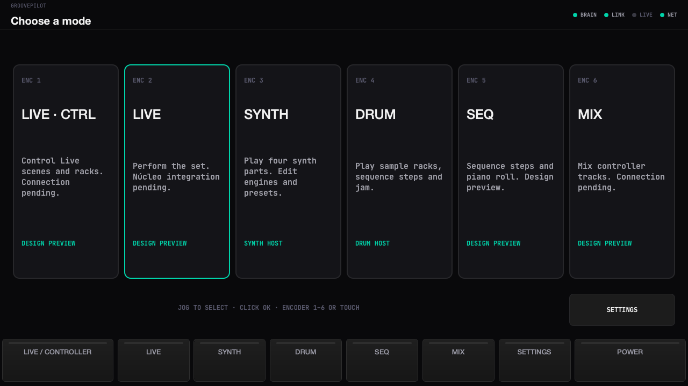
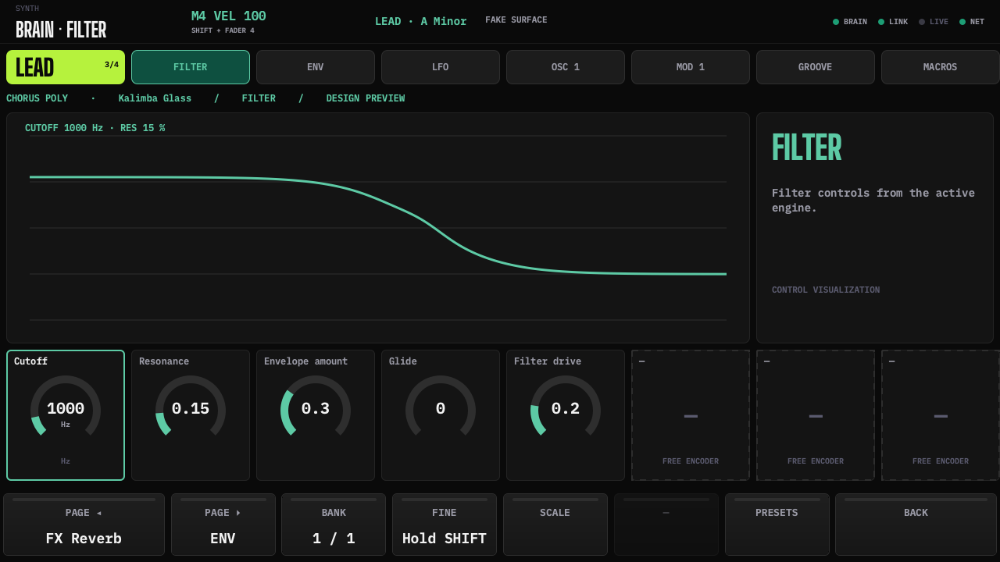
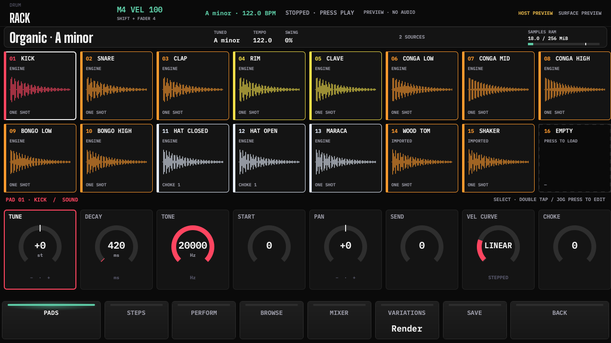
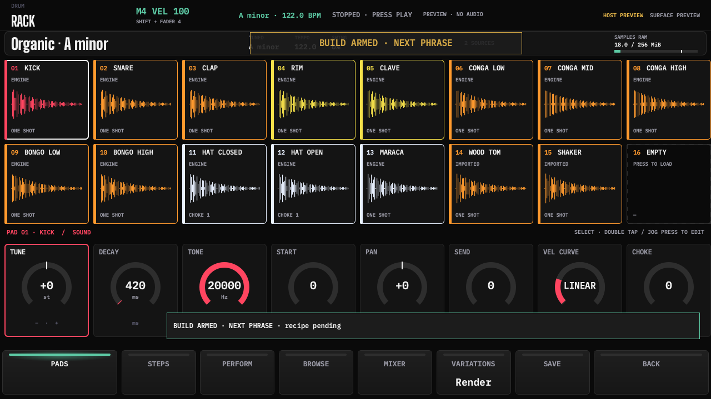

# Consola v1 · botones (2026-11-11)

Spec primero: 18 §3 fija el mapa MIDI; 21/22 documentan navegación, hooks y límites;
25 §3 queda sincronizado. No se cambiaron specs00–06, hardware ni recetas musicales.

- Cuatro MCP,36 contactos activos; GPA7/GPB7 y contactos libres ignorados.
  ENC1–4=GPB0–3, ENC5–8=GPA0–3; JOG88 y pedal122 ahora en0x23.
  Notas108/109 reservadas para manos. Perfil mínimo conserva sus máscaras;
  full habilita0x20–23. Desconexión libera una vez; backoff1–32s conservado.
- MENU abre modos y Settings; BACK recupera historial; LEFT/RIGHT cambian páginas;
  BROWSE abre biblioteca/presets/sonidos del contexto. Jog selecciona, clic confirma.
  LIVE/controller y LIVE/standalone siguen separados; SEQ y MIX son pantallas de
  diseño existentes, señaladas como preview, sin simular conexión al núcleo.
- Columna derecha: OCT+, OCT−, PAGE◀, PAGE▶ emiten scene1,2,3,4 en LIVE/controller.
  `ConsoleButtons.intentRequested` es el hook pendiente (`pending=True`), con aviso
  visible. No existe implementación de núcleo/scene launch en este checkout.
  SYNTH conserva transposición inmediata antes del siguiente pad y páginas.
- TAP promedia hasta4 intervalos monotónicos, reset2s, BPM60–200; usa el transporte
  DRUM/host. Corriendo muestra aviso sin detenerlo:22 sólo permite editar BPM detenido.
  CUE usa preview DRUM; otros CUE y FILL son hooks pendientes con aviso.
- BUILD/DROP/BREAK arman/cancelan una intención; una sección a la vez, indicador
  parpadeante en todos los modos, SHIFT=próximo compás, normal=próxima frase.
  `execute_section()` sólo emite hook pendiente: no hay temporizador musical ni
  recetas inventadas. ACCEPT sigue siendo soft key según19.

## Diferencias de specs que requieren cierre físico/funcional

1. **0x23 no aparece en CONNECTORS.** 18 fija provisionalmente GPA0–6=CUE,FILL,TAP,
   BUILD,DROP,BREAK,JOG y GPB0=PEDAL. Validar al diseñar PCB-M. K2 aún tiene nombres
   viejos: BROWSE→BACK, MIX→MENU, DEVICE→LEFT, NOTE→RIGHT, SESSION→BROWSE.
2. La mesa mínima descrita antes como ENC1–4 en GPA0–3 contradice CONNECTORS:
   esos contactos son ENC5–8. Se respeta el GPIO real, sin reasignar notas por perfil.
3. **DRUM no especifica octavas:** sus16 pads son fijos. OCT± emite `drum_octave`
   pendiente con delta±1 y aviso, sin transponer samples ni inventar un banco.
4. **LEDs de teclas pendientes de PCB-K.** Doc23 sólo cubre los32 pads M4. Colores
   previstos de columna: verde LIVE, azul SYNTH, ámbar DRUM (`sceneColor`); sin
   mensajes MIDI LED inventados. El blink TAP físico también queda pendiente.
5. **Alineación exacta imposible con las medidas dadas.** Pantalla x92,5–247,5mm;
   ejes x79+26i. Proyección `(79+26i−92,5)/0,12109`:
   −111,49;103,23;317,95;532,66;747,38;962,09;1176,81;1391,53px.
   Los extremos están fuera de1280px;182mm de encoders no caben en155mm.
   Se aplica un compromiso visible común a todas las pantallas: dos celdas extremas
   de214,72px y seis interiores de141,76px, menos8px de separación, etiquetas
   centradas. **No certifica etiquetas sobre ejes físicos**, tampoco las interiores.
   Hace falta revisar paso/área activa o aceptar expresamente ese compromiso.

## Capturas y verificación

Generadas con `QT_QPA_PLATFORM=offscreen python3 tools/buttons_review.py` desde
`apps/consola/gui-console`;1280×720, software, preview silencioso, QML0°, sin warnings.
`manifest.json` registra procedencia. Inspección visual desktop; sin flash, Pi ni audio físico.

- `pio test -e native`:188/188; mapa completo/máscaras, colisiones, unplug y backoff.
- `pio run -e consola_uno`:SUCCESS; `pio run -e consola_uno_full`:SUCCESS.
- GUI `QT_QPA_PLATFORM=offscreen python3 -m pytest -q`:523 passed,13 skipped
  (skips preexistentes de sockets restringidos y fuente General Sans).
- Pruebas nuevas:28 casos de MENU/jog, modos, escenas, TAP, CUE/FILL y arm/cancel;
  pasada dirigida repetida tras explicitar OCT± pendiente de DRUM.
- Decodificador `tools/consola`:443 passed en `tests/test_superficie.py`.
- La suite GUI conserva regresiones touch/rotación, LEDs, SHIFT+fader4 y SHIFT+pad.

PlatformIO: `~/.platformio/penv/bin/pio`, `PLATFORMIO_CORE_DIR=/private/tmp/gf-unica-pio-core`,
`PLATFORMIO_SETTING_ENABLE_TELEMETRY=no`; Unity2.6.1 instalada en `.pio/libdeps` desde
la caché local (sin red). No commits ni staging de contenidos; sólo intent-to-add
para incluir archivos nuevos y PNG en el parche binario solicitado.
