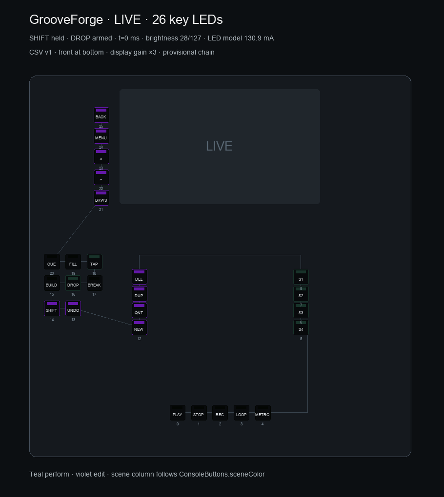
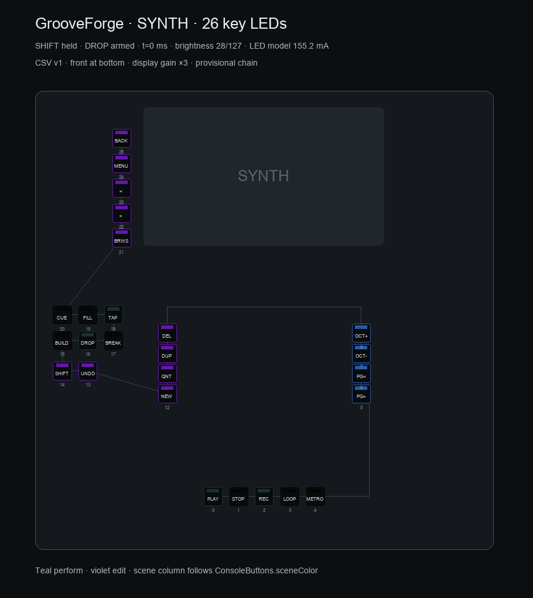
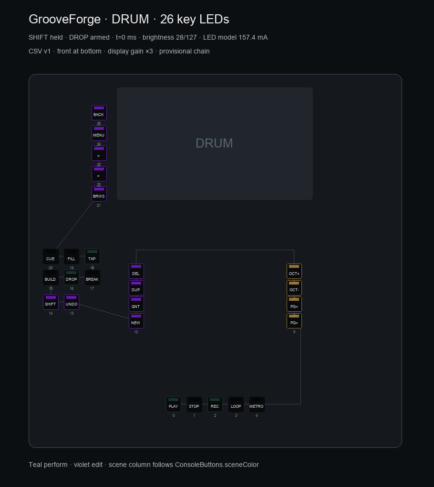

# Console · 26 key LEDs (LED27)

Base: `claude/monorepo-groovepush` at `02ffe1a`.
All work stays in `/private/tmp/grooveforge-keyleds1`; no commit or upload.
Spec/theory preceded code: [27-leds-teclas.md](../../../../docs/consola/27-leds-teclas.md).
The LED23/M4 protocol is unchanged; doc23 links the independent extension.

## Result

- 26-key provisional PCB-K chain follows the CSV, with routing bends outside the
  pad/FSR windows. Indices are provisional until PCB-K layout is approved.
- Channel16 CC102=27 opts into key state; CC103–106 atomically apply index,
  state and palette. Shared CC25/26/28 retain pad brightness/animation/beat
  meanings. Keys never use M4 pad notes48–79 or the UART return path.
- Pi uses the existing `LedOutput`, one coalescing gate34ms for pads and keys,
  periodic snapshots1s and independent UI heartbeat2Hz. Reconnect/failure
  restarts the key transaction stream; other MIDI channels keep their meaning.
- `ConsoleButtons.sceneColor` drives the scene column (LIVE teal, SYNTH blue,
  DRUM amber). SHIFT is bright while held, an armed section blinks, TAP follows
  confirmed host beats while running or previews the current TAP tempo stopped.
  Section/scene intentions remain pending; LEDs do not claim execution.
- Violet=(150,40,255), compensated teal=(37,81,66), before final brightness.
  Settings controls both paths, including brightness0 and animations OFF.
- Custom pin13 driver adapts PJRC Octo timing/QTIMER4+XBAR, with three DMA channels
  and one full precomputed624-bit frame. No LED ISR, UART use, waiting loop,
  interrupt masking, heap, I2S changes or NVIC priority changes. It leaves a300µs
  latch interval and returns immediately when DMA is busy.
- LED current model includes26mA idle and20mA/canal at full PWM. A proportional
  hard limit at500mA reserves100mA of doc24's600mA branch for Sharp/buffer/margin.
  Every final channel is also capped at62/255 (brightness31/127). Modelled white
  on all26 is405.3mA. This is an estimate, not measured current.

## Rendered previews

Images use the **production C++ `KeyLedReturn` renderer**, fed by the Pi
`key_frame`/`key_messages` generator and `ConsoleButtons.sceneColor`. All26 keys
are placed at exact CSV centres, with y inverted for a front-at-bottom view.
SHIFT held and DROP armed illustrate feedback. No keycap geometry has moved.
The route is illustrative, not copper. Screen is a contextual outline.

Display gain×3 helps inspect PWM levels on a monitor; it is not a physical
luminance simulation. Initial frame t=0ms, brightness28/127. The timeline in
[preview.html](preview.html) paints93 precomputed firmware frames; JS does not
implement blink/pulse/limiter logic. Raw bytes/current: [frames.json](frames.json).

| Mode | Scene column | Modelled LED current across1.02s |
|---|---|---|
| LIVE | compensated teal |125.4–130.9mA|
| SYNTH | blue |149.7–155.2mA|
| DRUM | amber |151.9–157.4mA|







SVG originals: [LIVE](live.svg), [SYNTH](synth.svg), [DRUM](drum.svg).
PNG/SVGs were inspected for position, label and palette differences; each SVG
contains exactly26 keys.

Reproduce from checkout root:

```sh
python3 apps/consola/gui-console/tools/preview_key_leds.py
```

Requires a C++17 compiler, PySide6 and Pillow. Temporary executable is inside the
checkout's ignored `.pio/key-led-preview/`. Generator and C++ adapter are in
`gui-console/tools/preview_key_leds.py` and `key_led_preview.cpp`.

## Breadboard demo (no flashing performed here)

Use `consola_uno` on the minimal bench or `consola_uno_full` with the full panel.
Wire pin13 → AHCT input; AHCT VCC5V, /OE low, buffer output → first SK6812 DIN.
Use common GND, a suitable5V LED supply/branch and local decoupling; preserve
separate USB5V branches and the doc24 protection. Connect actual RGB MINI-E,
not a32-bit RGBW part. Do not enable Audio Shield SPI/SD on pin13.

Over the existing CDC port, send:

```text
@GF KEYLEDS 3
```

The first3 pixels cycle teal, violet, blue, amber, white every1s; remaining
pixels are black. The same brightness and current limits apply. The cycle
expires after60s. `@GF KEYLEDS 0` restores the current Pi state immediately at
the next34ms render; without a live Pi heartbeat that state is black.
Other counts1–26 work; malformed commands are rejected.

`@S STATS` includes `key_led_ua` (modelled microamps), alongside existing audio,
USB, FSR and loop statistics. Settings brightness0 keeps even the demo black.

## Verification

| Check | Final result |
|---|---|
| `pio run -e consola_uno` | PASS |
| `pio run -e consola_uno_full` | PASS |
| `pio test -e native` | **196 passed** (8 new key tests) |
| `QT_QPA_PLATFORM=offscreen python3 -m pytest -q` | **528 passed, 13 skipped**,199.48s |
| Production C++ preview |93 frames,26 keys/mode; all≤500mA and all channels≤62 |
| `git diff --check` | PASS |

Firmware checks use `~/.platformio/penv/bin/pio` from `apps/firmware-teensy`;
pytest runs from `apps/consola/gui-console`. Skipped GUI cases retain their
existing platform/environment conditions. Logs: `builds-final.log`,
`native-final.log`, `gui-final.log` in the working checkout (ignored). Native tests exercise atomic rejection, pad/channel isolation, the final
colour cap, off/dim/on/blink/pulse, animation disable, TAP serial dedup/beat/tempo,
frame gate/rollover, timeout/recovery, limiter and bench grammar/count/expiry.
GUI tests cover all26 CSV refs, mode colours, SHIFT/arm states, shared Settings,
TAP/host freshness, coalesced diffs, snapshots, reconnect and partial send failure.
The five new GUI cases cover these integrations. Existing pad tests now include the additional110-message key snapshot in their
budget; their32 pad note applications and RGB ordering remain asserted.

PlatformIO uses installed packages and a cached Unity copy under ignored `.pio/`;
`PLATFORMIO_CORE_DIR=/private/tmp/grooveforge-keyleds1/.pio/core` and telemetry disabled. No framework
installation was modified. Logs are ignored files at checkout root.

## Physical gate still open

Desktop builds/tests do not certify wire timing or xrun-free audio. Before using
the combined firmware on stage: scope GRB/timing/reset after the buffer, measure
the actual LED branch current against0.6A, verify the colour compensation through
the real cap in daylight, and run audio duplex60min with FSR/M4/GUI active.
Check zero USB/audio drops and `loop_max_us<2000` after `@S RESET`.
QTIMER4 channels0–2 and XBAR request30/31/94 now belong to the key driver; no
other PWM/tone/Octo instance may claim those resources. PJRC timing source and
alternatives are documented in doc27 §4.
