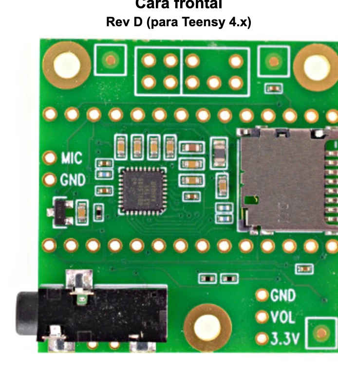
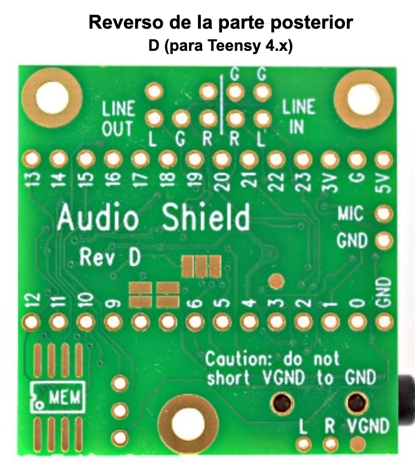

# PCB-M — Placa Principal GrooveForge Consola

> Esquemático jerárquico KiCad 10, decisiones **D8–D43 aprobadas por Juan (2026-11-12; D40 actualizado 2026-11-13)**
> (`apps/docs/consola/24-placa-principal.md` §8). Sin layout PCB; no es aprobación de fabricación.
> Descripción eléctrica: `tools/schgen/pcb_m.py`. Firmware: `apps/consola/surface/include/consola_s/ConsolaMap.h`
> y `apps/docs/consola/17-mapa-pines-teensy.md`. Conector fabricado: `../CONNECTORS.md`.

No habrá PCB-N: jog, pots IN/CUE/MASTER, selector y audífonos son componentes de panel por cable.
PCB-M no lleva MCP23017: **0x20 está en PCB-A; 0x21/0x22/0x23 en la PCB-K única**, que reemplaza
K1/K2. JOG_A/B van a Teensy 37/40; JOG_CLICK y PEDAL_BTN viajan por J_PCB_K al MCP 0x23.

## Bloques (10 subhojas)

| # | Hoja | Contenido |
|---|---|---|
| 01 | `01-teensy` | Sockets Teensy 4.1 y Audio Shield Rev D (módulos); I2S interno |
| 02 | `02-analog-front` | Frente Studio: pad 33k/12k/5.1k, polos A/B del selector por cable, acople 1µF, 1k, BAT54S, bias 100k a VREF; MCP6004 seguidores L/R/VREF; LINE OUT 10µF + 47k sin buffer; divisor PAD_SEL 10k/10k |
| 03 | `03-adc` | ADS1115 0x48 faders AIN0–3; 0x49 expresión/Sharp |
| 04 | `04-mcp-io` | **Vacía**, reservada; MCP 0x23 vive en PCB-K |
| 05 | `05-cv-dac` | MCP4725 0x60/0x61, MCP6004 ganancia 1,5; 1k serie + BAT54S por CV |
| 06 | `06-surface` | JST-PH para jog, pots, selector, HP y FSR; RC 1k/100nF por pot |
| 07 | `07-midi` | **Todo DNP**, reserva sin agujeros/mazos: opto 6N138 y polarización; JST-PH para MIDI TRS **tipo A**, OUT 33Ω/10Ω |
| 08 | `08-connectors-panel` | IDC PCB-A, Qwiic, Serial7 M4, PCB-K, Sharp/expresión |
| 09 | `09-connectors-rear` | JST-PH hacia LINE IN/OUT, CV, pedal; E-drum DNP |
| 11 | `11-diagnostics` | TP, puentes de servicio, indicadores y selección de pull-ups locales |
| 12 | `12-i2c-branches` | PCA9517A ×2, EN_K pin0 / EN_A pin1, pull-ups B, 47 Ω y USBLC6-2SC6 |
| 10 | `10-power` | J_5V_LED_IN → F1; LDO +3.3VA; NT1 AGND/GND; buffer LED y pull-ups I2C |

## Cross-reference: Teensy ↔ señales de PCB-A y panel (D8)

**Manda el pinout de PCB-A ya fabricada**, no la antigua columna Teensy de CONNECTORS.md.
Cinta IDC **1:1**. PCB-M distribuye cada señal al pin que usa el firmware actual:

| Teensy | Función | Net PCB-M | Ruta |
|---|---|---|---|
| T0 / T1 | EN_K / EN_A | `EN_K_GPIO` / `EN_A_GPIO` | Cada rama por su SJ_EN_K_GPIO / SJ_EN_A_GPIO y pull-up 10k (D30); MIDI DNP |
| T2 / T3 | ENC1 A/B | `ENC1_A` / `ENC1_B` | J1_PCBA **5 / 7** |
| T4 / T5 | ENC2 A/B | `ENC2_A` / `ENC2_B` | J1_PCBA **9 / 10** |
| T6 / T9 | ENC3 A/B | `ENC3_A` / `ENC3_B` | J1_PCBA **13 / 15** |
| T10 / T11 | ENC4 A/B | `ENC4_A` / `ENC4_B` | J1_PCBA **17 / 19** |
| T12 / T30 | ENC5 A/B | `ENC5_A` / `ENC5_B` | J1_PCBA **8 / 21** |
| T31 / T32 | ENC6 A/B | `ENC6_A` / `ENC6_B` | J1_PCBA **23 / 25** |
| T33 / T34 | ENC7 A/B | `ENC7_A` / `ENC7_B` | J1_PCBA **28 / 29** |
| T35 / T36 | ENC8 A/B | `ENC8_A` / `ENC8_B` | J1_PCBA **27 / 24** |
| T13 | LEDs teclas | `LED_DATA` | 74AHCT1G125 → `LED_DIN_5V` → **J_PCB_K.6**; J1.26 NC |
| T14–T17 | FSR velocity 1–4 | `FSR1_ADC`–`FSR4_ADC` | J_FSR1–4, divisor 10k a GND |
| T18 / T19 | I2C SDA/SCL | `I2C_SDA` / `I2C_SCL` | lado A de PCA9517A y convertidores; B_A → J2_I2C.3/.4; B_K → J_PCB_K.2/.4 |
| T22 | MASTER | `POT_MASTER` | J_POT_MASTER.2 → **1k → ADC; 100nF a GND** |
| T24 | CUE | `POT_CUE` | J_POT_CUE.2 → **1k → ADC; 100nF a GND** |
| T26 | IN | `POT_IN` | J_POT_IN.2 → **1k → ADC; 100nF a GND** |
| T28 / T29 | M4 RX/TX Serial7 | `M4_RX7` / `M4_TX7` | J3_M4.3 / .4 ↔ pads SDA/TX M4 / SCL/RX M4, vía 1 kΩ cada línea |
| T37 / T40 | Jog A/B | `JOG_A` / `JOG_B` | J_JOG.2/.3; clic por .4 hacia PCB-K |
| T41 | Selector pad | `PAD_SEL_ADC` | J_PAD_SEL.2 y divisor permanente 10k/10k |
| T7 / T8 / T20 / T21 / T23 | I2S TX/RX/LRCLK/BCLK/MCLK | `I2S_*` | Internos al módulo Audio Shield; sin ruta al panel |
| T25 / T27 / T38 / T39 | E-drum reservado | NC | No se asigna función nueva; J_EDRUM DNP |

| Señal de PCB-A | J1_PCBA | Destino PCB-M |
|---|---|---|
| FADER1 / FADER2 / FADER3 / FADER4 | **16 / 14 / 12 / 11** | U_ADS1 **AIN0 / AIN1 / AIN2 / AIN3** (pines 4/5/6/7), dirección **0x48** |
| +5V | 1 / 2 | +5V_LED después de F1 |
| GND | 3 / 4 / 6 | GND |
| +3V3 | 30 | +3.3V digital |
| Spare | **18** | **NC**, sin uso |
| INT_K / INT_A | **20 / 22** | **NC**, MCP por sondeo I2C |
| LED_DIN | **26** | **NC**, LED solo por J_PCB_K |

**I2C no va por el IDC J1:** llega a PCB-A por J2. La PCB-A fabricada no se modifica salvo
**desoldar R1/R2** al instalar PCB-M (D14). No conectar además la antigua cadena PCB-A J4 → K1/K2
al usar la nueva PCB-K por J_PCB_K.

## Conectores hacia panel y otras placas

PH = JST-PH 2,0 mm; normalmente BnB-PH-K vertical. J_5V_LED_IN usa S2B-PH-K horizontal de la BOM.

| Ref | Tipo | Pines en orden 1→n |
|---|---|---|
| J1_PCBA | IDC 2×15 | Pinout fabricado de CONNECTORS.md; destinos en tablas anteriores |
| J2_I2C | JST-SH 4 Qwiic | GND / +3.3V / SDA / SCL |
| J3_M4 | PH 4 | GND / **NC** / M4_RX7_CABLE / M4_TX7_CABLE; pads M4 por rótulo (D40), vía 1 kΩ por señal; M4 por USB propio |
| J_PCB_K | PH 10 C158038 | +3.3V / SDA_B_K / GND / SCL_B_K / GND / LED_DIN_5V / GND / +5V_LED_K / JOG_CLICK / PEDAL_BTN |
| J5_SHARP1, J6_SHARP2 | PH 3 cada uno | +5V_LED / SHARPx_RAW / GND; 10k serie hacia ADS |
| J7_EXP1, J8_EXP2 | PH 2 cada uno | +3.3V / EXPx_ADC, pulldown 10k |
| J_JOG | PH 4 | GND / JOG_A / JOG_B / JOG_CLICK |
| J_POT_MASTER/CUE/IN | PH 3 cada uno | +3.3V / POT_x_WIPER / GND; cursor **antes** del RC |
| J_PAD_SEL | PH 3 | +3.3V / PAD_SEL_ADC / GND |
| J_FSR1–4 | PH 2 cada uno | +3.3V / FSRx_ADC; pulldown 10k |
| J_5V_LED_IN | PH 2 S2B-PH-K | **+5V_LED_RAW / GND** desde cable USB-A del Pi |
| J_5V_BKUP | PH 2, **DNP** | +5V_LED_RAW / GND; solo alternativa, no conectar ambas entradas |
| J_EDRUM | PH 5, **DNP** | Todos NC |

### Cableado jack ↔ JST-PH (D15)

Los jacks se compran en **Bogotá**, se fijan **con tuerca a la pared trasera del cuerpo** y van
por cable a los JST-PH del borde trasero de PCB-M. No hay jacks montados en esta PCB. Las hojas
06/07/09 son agrupaciones eléctricas: colocar J_HP en el borde trasero; JST MIDI DNP, sin mazos ni agujeros
cuando se haga layout. Confirmar por continuidad los terminales del jack comprado antes de soldar;
la tabla usa **T = tip/punta, R = ring/anillo, S = sleeve/manguito**, no la numeración de sus patillas.

| Jack externo | Ref en PCB-M | JST-PH | Cableado hacia contactos del jack |
|---|---|---|---|
| LINE IN L 6,35 mm TRS | J_LINE_IN_L | B3B-PH-K, 3 vías | **1→T** LINE_IN_L_T, **2→R** LINE_IN_L_R, **3→S** AGND |
| LINE IN R 6,35 mm TRS | J_LINE_IN_R | B3B-PH-K, 3 vías | **1→T** LINE_IN_R_T, **2→R** LINE_IN_R_R, **3→S** AGND |
| LINE OUT L 6,35 mm TS/TRS | J_LINE_OUT_L | B3B-PH-K, 3 vías | **1→T** LINE_OUT_L_T después de 10µF, **2 NC**, **3→S** AGND; ring sin cable si es TRS |
| LINE OUT R 6,35 mm TS/TRS | J_LINE_OUT_R | B3B-PH-K, 3 vías | **1→T** LINE_OUT_R_T después de 10µF, **2 NC**, **3→S** AGND; ring sin cable si es TRS |
| PEDAL 6,35 mm TRS | J_PEDAL | B3B-PH-K, 3 vías | **1→T** PEDAL_RAW (1k → PEDAL_BTN protegido), **2 NC** (R sin cable), **3→S** GND |
| CV1 3,5 mm TS | J_CV1 | B2B-PH-K, 2 vías | **1→T** CV1_PROTECTED, **2→S** AGND |
| CV2 3,5 mm TS | J_CV2 | B2B-PH-K, 2 vías | **1→T** CV2_PROTECTED, **2→S** AGND |
| MIDI IN 3,5 mm TRS **tipo A** | J_MIDI_IN | B3B-PH-K, 3 vías | **1→T** MIDI_IN_TIP (DIN5), **2→R** MIDI_IN_RING (DIN4), **3 NC** (sleeve/DIN2 sin cable) |
| MIDI OUT 3,5 mm TRS **tipo A** | J_MIDI_OUT | B3B-PH-K, 3 vías | **1→T** MIDI_OUT_TIP (DIN5), **2→R** MIDI_OUT_RING (DIN4), **3→S** GND (DIN2) |
| Audífonos cue 6,35 mm TRS | **J_HP** (06) | B3B-PH-K, 3 vías | **1→T** HP_L, **2→R** HP_R, **3→S** HP_VGND |

**HP_VGND es una salida activa del SGTL5000, nunca GND/AGND.** Se elimina el duplicado J_HP_CUE:
J_HP es el único conector hacia el jack de audífonos que ya iba por cable.
**Detección de inserción:** los símbolos anteriores eran AudioJack2/3 sin switches; ninguno tenía
pin ni red de detección. Por tanto se conservan todos sus contactos actuales y no se inventa un
pin de detección. Si el jack adquirido trae contactos conmutados, dejarlos sin cable y verificar
que T/R/S se identificaron correctamente. **LINE IN ring sigue sin terminación balanceada definida**;
se conserva la red por cable, pendiente de decisión eléctrica antes de fabricar.

### Selector en panel (D13)

R_SEL_T/R_SEL_B de 10k quedan en PCB-M: +3.3V → 10k → **PAD_SEL_ADC** → 10k → GND.
Se elimina **SW_PAD_SEL**. Cablear el **común del polo C** a J_PAD_SEL.2, sus contactos extremos
a .3 (GND) y .1 (+3,3 V), y **dejar el contacto central sin cable**. Lectura 0 / 1,65 / 3,3 V;
no se necesita un cuarto hilo ni una escalera en el panel. La correspondencia con 0/−10/−20 dB
se verifica con los polos A/B y el firmware en banco.
SW_PAD representa los polos A/B del selector de panel, con header 2×4 en PCB-M: contactos
1 LINE_IN_L_T, 2 TAP10_L, 3 común PAD_L, 4 TAP20_L; 5 LINE_IN_R_T, 6 TAP10_R,
7 común PAD_R, 8 TAP20_R. No montar un selector en la placa.

## Alimentación, masas y protecciones (D9–D12/D14)

Cable USB-A del Pi (solo alimentación): VBUS → J_5V_LED_IN.1, GND → .2.
F1 **MF-MSMF075/24-2, 0,75 A, 1812** → +5V_LED_FUSED → AO3401A (D entrada, S carga, G GND)
→ +5V_LED. SMAJ5.0A unidireccional a GND después del fusible: un corto sostenido de TVS
queda limitado por F1. El riel +5V_LED alimenta solo LEDs (incluido indicador), buffer 74AHCT1G125 y Sharp.
PMOS: caída ≤43 mV a 0,5 A usando 85 mΩ, disipación ≈21 mW; evita ≈0,2–0,25 V de Schottky.
TVS: 5 V es standoff, clamp nominal máximo 9,2 V al pulso especificado; no es regulación a 5 V.
Medir transitorios con mazo final y no usar para aceptar sobretensión continua.

**+5V_TEENSY procede solo del USB propio de la Teensy desde Pi. NO cortar VUSB–VIN.**
PCB-M no inyecta alimentación en ese rail. IN/EN y C_IN del TLV75533 están en +5V_TEENSY;
+3.3VA alimenta ADS y frente. Faders/FSR/pots/DAC van a +3.3V de Teensy.
El amplificador CV y sus clamps superiores usan +5V_CV desde +5V_TEENSY por
SJ_CV + 10 Ω + 47 µF; conserva desacoplos 100 nF/10 µF. Sin USB LED, CV/ADS/frente
siguen activos y Sharp/LED/buffer quedan apagados. Sin USB Teensy el dominio analógico
y CV quedan apagados aunque Sharp/LED tengan 5 V. Sharp→ADS 10k (≤0,5 mA con 5 V forzados);
DAC→CV 2,2k (≤1,5 mA con 3,3 V). Son límites de corriente, no garantía de tensión válida ni
lecturas correctas sin VDD. Referencias y ensayos de secuencia: doc24 D26.

**NT1 Device:NetTie_2 / NetTie:NetTie-2_SMD_Pad0.5mm**, pin1 AGND, pin2 GND, es la única unión
entre estas redes. En layout colocarlo **junto a U_LDO1**, regulador de +3.3VA; no crear puentes
adicionales ni unir HP_VGND. El netlist conserva los nombres GND/AGND y la huella define la unión
de cobre admitida por DRC; el esquema no prueba la colocación física.

Cada CV tiene **1k serie** desde CVx_OUT (realimentación antes del resistor) hasta
**CVx_PROTECTED** en el cable, con **BAT54S**: pin1 GND, pin2 +5V_CV (D38), pin3 nodo protegido.
Cada pot lleva **1k desde cursor, 100nF y 100k a GND en lado ADC** (D42). Cable abierto τ≈10ms, umbral 0,15V/100ms; no distingue pot mínimo. Pot10k: error máximo ≈2,108% FS (media escala ≈1,691% FS); cota relativa 3,382%. Entrada LED desde T13 con 100k a GND define reposo durante reset.

Pedal: J_PEDAL tip → 1k → PEDAL_BTN → J_PCB_K.10, ESD PESD3V3U1UL unidireccional 3,3V (K señal/A GND), pull-up10k a 3,3V y 10nF a GND junto al conector.

Ambos canales CV quedan poblados. Firmware debe inicializar **0x60 y 0x61** a cero al inicio de setup y provisionar/verificar EEPROM cero una vez. No hay mute de hardware; un reset solo MCU conserva la salida anterior hasta escritura. No escribir EEPROM en cada arranque.

Reserva **DNP** MIDI OUT **3,3 V tipo A**: R_MIDI_R **33Ω ≥0,5W** de +3.3V a ring, R_MIDI_T **10Ω ≥0,25W**
de MIDI_TX a tip. Se elimina R_MIDI_S=100Ω y la anterior pareja de 47Ω. Referencia:
[MIDI Association, CA-033 (2014)](https://midi.org/5-pin-din-electrical-specs),
[figura 1, p.2, publicada por AMEI](https://amei.or.jp/midistandardcommittee/Recommended_Practice/ca33-j.pdf).
Footprints 1210/1206 respectivamente; seleccionar resistores con esa potencia nominal.

**Pull-ups I2C en PCB-M:** R_SDA/R_SCL 2,2k locales y un par de 2,2k por lado B de los PCA9517A; cada segmento permite cambiar a 4,7k mediante puentes (doc24 §10). **Desoldar R1/R2 de PCB-A** al integrarla;
con ambos pares quedarían 1,1k. No modificar pistas ni el pinout de PCB-A. Revisar el total de
pull-ups de los módulos ya instalados antes de elevar el bus a 400kHz.

## BOM y anotación

La **BOM se exporta del esquema KiCad** con Reference, Value, Footprint, LCSC y DNP a
`../../fab/bom-pcb-m.csv`. Este README no contiene una tabla paralela de códigos de compra.
`../../tools/lcsc_catalog.json` registra identidades y encapsulados verificados, fuentes y fecha;
`check_bom.py` detecta códigos ausentes/no verificados o huellas incompatibles. Componentes sin
identidad confirmada y sin suministro externo declarado impedirían el cierre. Ver estado actual
de las seis BOM y límites físicos en [REPORT-fixrev2.md](../../tools/REPORT-fixrev2.md).
No comprar desde una tabla histórica. DNP excluye ensamble; pads TP, puentes y NT son cobre,
no piezas compradas. MIDI de hoja07/TP/ajustes permanece DNP e `in_bom no`.

Para completar anotación KiCad se añadió **1 final a cada referencia que terminaba en letra**
(p. ej. J_PCB_K → J_PCB_K1, U_LED_BUF → U_LED_BUF1). Las tablas del spec conservan nombres
funcionales; el campo **Function** permite cruzarlos con Reference. No se retoca el CSV exportado
ni se elimina «?» por posproceso; el test usa las referencias reales del exportador.
Ver `docs/reference-map.csv` para el mapa completo. Pines y redes conservan sus identidades.

## Montaje del Audio Shield Rev D — contrato físico D28

Los tres JST-PH de PCB-M son **funcionales hacia un mazo corto soldado**, no huellas del
header original. Vista del **reverso**, orientada como la foto: pads a paso **2,54 mm**.
Fila inferior izquierda→derecha: **LINE OUT L, G, R, LINE IN R, LINE IN L**.
Fila superior: **G sobre LINE IN R, G sobre LINE IN L**; los dos pads **sin rótulo** sobre
LINE OUT L/R se dejan **sin cable**. No deducir señales de su posición.

| Pad del shield, visto desde reverso | Función en PCB-M | Pin JST-PH |
|---|---|---|
| inferior LINE IN L, extremo derecho | J_SHIELD_IN (Reference J_SHIELD_IN1) | 1 |
| inferior LINE IN R | J_SHIELD_IN | 2 |
| superior G sobre LINE IN L | J_SHIELD_IN | 3 GND |
| inferior LINE OUT L, extremo izquierdo | J_SHIELD_OUT (Reference J_SHIELD_OUT1) | 1 |
| inferior LINE OUT R | J_SHIELD_OUT | 2 |
| inferior LINE OUT G, entre L/R | J_SHIELD_OUT | 3 GND |
| abajo derecha L | J_SHIELD_HP (Reference J_SHIELD_HP1) | 1 |
| abajo derecha R | J_SHIELD_HP | 2 |
| abajo derecha VGND | J_SHIELD_HP | 3 HP_VGND |
| superior G sobre LINE IN R | sin segundo retorno de mazo | NC (G de módulo) |
| dos pads superiores sin rótulo | desconocidos; NO conectar | NC |

**Advertencia impresa en módulo y esquema: VGND ≠ GND; do not short VGND to GND.**
Aislar sleeve de audífonos del chasis/GND/AGND y verificar continuidad antes de alimentar.
Los pads G del shield comparten GND con Teensy por sus headers; llevarlos a **GND**, no añadir una segunda unión AGND/GND por el mazo. NT1 conserva la unión estrella.
El mazo queda registrado en harness.py como cable a módulo con contactos nombrados.





Checklist completa: [ASSEMBLY.md](ASSEMBLY.md). Pendientes físicos: cupones Choc/LED, montaje/altura
FSR, terminación ring de LINE IN, arranque códec con 26LED y mediciones CV/alimentación.
No se declara aprobación de fabricación desde ERC.

## Dimensiones y layout pendiente

Referencia `25-panel-consola.md`: PCB-M **186 × 80 mm** (Juan, 2026-11-13: crece 20 mm hacia el frente para redistribuir en 2 capas), x140–326 / y256–336 mm en panel, 8 agujeros M3 (dos nuevos en (144, 260) y (322, 260)).
Los jacks pertenecen a la pared del cuerpo: sus pitches no fijan las huellas de PCB-M. Colocar los
JST de cada jack en el borde trasero, J_PCB_K hacia el centro e IDC J1 hacia PCB-A; NT1 junto a U_LDO1.
El archivo `.kicad_pcb` y el proyecto no se modifican en esta captura; la colocación queda pendiente.

## Regeneración y verificación

Desde la raíz:

```sh
python3 -m pytest -q apps/hardware/kicad/consola/tools/tests --basetemp=.schgen-test-tmp
python3 apps/hardware/kicad/consola/tools/check_netlist.py --regenerate
```

No editar las hojas generadas; cambiar `tools/schgen/pcb_m.py`. Sin `--regenerate` se verifican
las hojas existentes sin sobrescribirlas. XML compara pines, NC y particiones/nombres de redes;
ERC no acredita montaje ni rendimiento analógico. Son **11 páginas** (raíz + 10 subhojas).

Los resultados de esta corrección se registran en [REPORT-fixrev.md](../../tools/REPORT-fixrev.md).
El netlist, ERC y PDF de `docs/` se regeneran juntos. Los siete avisos de PCB-M son cinco
señales I2S internas al módulo y dos anillos LINE IN sin terminación. No hay exclusiones nuevas.


Segunda revisión, D40 (decisión de Juan 2026-11-13): soldar el cable a los **pads rotulados
por función** de la NeoTrellis M4, sin depender de la numeración del conector.
Juan confirmará los rótulos impresos antes de soldar. M4 conserva su USB propio.

| Rótulo de pad M4 | Función M4 | J3_M4 (PCB-M) | Destino Teensy |
|---|---|---|---|
| SDA | TX M4 | 3 | → R_M4_RX1 1 kΩ → RX pin 28 |
| SCL | RX M4 | 4 | ← R_M4_TX1 1 kΩ ← TX pin 29 |
| GND | masa | 1 | GND |
| 3V | alimentación M4 | sin hilo (2 NC) | sin conectar |

R_M4_RX1/R_M4_TX1: 1 kΩ 0805, junto a J3_M4. UART real a 1 Mbps; cálculo RC y
ensayo de mazo requerido en doc24 D39. El checker valida pads por función y no conserva
un aviso pendiente por numeración del conector.
SJ_CV nace de +5V_TEENSY, conserva 10Ω/47µF. TVS unidireccionales: pad1=K a señal/riel,
pad2=A a GND; comprobar marca K de las huellas locales. Pots: pull-down 100k, doc24 D42.
