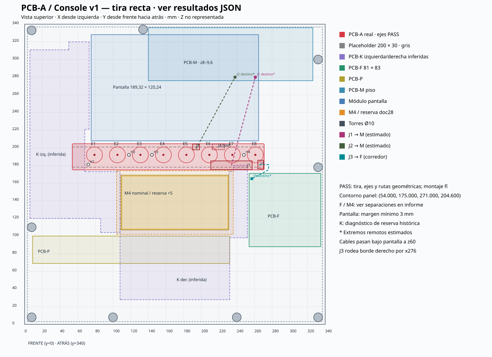

# PCB-A · fit de la tira Console v1

**PASS: tira, ejes y rutas geométricas; montaje físico pendiente**

Reproducir: `python3 -B apps/hardware/kicad/consola/tools/fit/check_pcba_fit.py`. La ejecución devuelve 1 si falla un criterio. Base: edc67a3. Método previo: [THEORY.md](THEORY.md); decisión: [THEORY-strip.md](../../boards/pcb-a/THEORY-strip.md).

## Ejes y contorno

Conversión fija esperada: (x+44, 371−y), mm. El ajuste sin escala entrega (44.000, 371.000). EC11 en F.Cu: eje local (+7,5; +2,5), distinto del origen. Esquinas R1 muestreadas cada ≤5°. Las colisiones usan la envolvente rectangular exterior conservadora, incluidos los pequeños recortes R1.

| Encoder | Eje KiCad | Objetivo panel | Eje panel | Error mm |
|---|---|---|---|---|
| RE1 | (35.000, 179.000) | (79.000, 192.000) | (79.000, 192.000) | 0.000000 |
| RE2 | (61.000, 179.000) | (105.000, 192.000) | (105.000, 192.000) | 0.000000 |
| RE3 | (87.000, 179.000) | (131.000, 192.000) | (131.000, 192.000) | 0.000000 |
| RE4 | (113.000, 179.000) | (157.000, 192.000) | (157.000, 192.000) | 0.000000 |
| RE5 | (139.000, 179.000) | (183.000, 192.000) | (183.000, 192.000) | 0.000000 |
| RE6 | (165.000, 179.000) | (209.000, 192.000) | (209.000, 192.000) | 0.000000 |
| RE7 | (191.000, 179.000) | (235.000, 192.000) | (235.000, 192.000) | 0.000000 |
| RE8 | (217.000, 179.000) | (261.000, 192.000) | (261.000, 192.000) | 0.000000 |

Paso: 26.000, 26.000, 26.000, 26.000, 26.000, 26.000, 26.000 mm. Límites panel (xmin,ymin,xmax,ymax): **(54.000, 175.000, 271.000, 204.600)**. Área muestreada: 6422.338 mm². Espesor 1,6 mm.

| Reserva | Solape mm² | Separación mm | Estado |
|---|---|---|---|
| PCB-K izquierda (partición inferida) | 414.4 | 0.0 | SOLAPE |
| PCB-K derecha (partición inferida) | 80.0 | 0.0 | SOLAPE |
| PCB-K v5 conjunto (conservador) | 494.4 | 0.0 | SOLAPE |
| Ventana M4 | 0.0 | 6.0 | LIBRE |
| M4 nominal CSV | 0.0 | 7.0 | LIBRE |
| M4 reserva doc28 (ventana +5 mm) | 0.0 | 1.0 | LIBRE |
| Pantalla módulo | 0.0 | 3.28 | LIBRE |
| PCB-F | 0.0 | 4.0 | LIBRE |
| PCB-P | 0.0 | 75.0 | LIBRE |
| PCB-M | 0.0 | 71.4 | LIBRE |

PCB-K se conserva como diagnóstico del CSV v5 combinado y partición inferida: no es el layout nuevo de K. Su proyección XY no integra el criterio de aprobación de esta tarea. Hay 15 mm nominales entre sustratos A/K; la interferencia de componentes y el paso de separadores requieren el modelo final. Pantalla debe tener ≥3 mm; F, M4 nominal, ventana y reserva M4 deben quedar LIBRES. No hay pines THT de A bajo F: [].

## Montaje para FreeCAD

| Agujero | KiCad mm | Panel mm | Taladro mm |
|---|---|---|---|
| H1 | (40.000, 192.000) | (84.000, 179.000) | 3.2 |
| H2 | (74.000, 179.000) | (118.000, 192.000) | 3.2 |
| H3 | (100.000, 179.000) | (144.000, 192.000) | 3.2 |
| H4 | (204.000, 179.000) | (248.000, 192.000) | 3.2 |

Cara inferior/superior A: z=63,4/65,0; chapa z=83…85. Separador nominal desde cara inferior de chapa a cara superior PCB: 18 mm. Agujeros NPTH Ø3,2 para M3; no son un bond de GND. Paso de separadores por K y puente de aluminio: [chequeo de montaje](REPORT-pcba-mounting.md). Placeholder antiguo: {'origin': [54, 178, 63.4], 'size': [217, 23, 1.6]}. No representa el nuevo contorno.

## Conectores y ruta del mazo

| Ref | Origen KiCad | Origen panel | Ángulo KiCad | Cara | Centro pads panel |
|---|---|---|---|---|---|
| J1 | (207.780, 192.070) | (251.780, 178.930) | 90.0 | B.Cu | (234.000, 180.200) |
| J2 | (150.000, 170.000) | (194.000, 201.000) | 0 | B.Cu | (194.000, 199.000) |
| J3 | (223.000, 190.000) | (267.000, 181.000) | -90.0 | B.Cu | (265.000, 181.000) |
| J4 | (175.000, 170.000) | (219.000, 201.000) | 0 | B.Cu | (219.000, 199.000) |

J1 largo paralelo a X, enchufe hacia abajo; cinta hacia PCB-M después de bajar a z60. J2 abre hacia atrás (+Y panel), baja a z60 antes de pasar por debajo de pantalla. J3 abre a la derecha (+X panel), rodea el borde derecho de A por x276 y va al J1 supuesto de F. J4/R1/R2 DNP. Todos los cables 1:1; conservar pin 1 y polarización.

| Ruta | Polilínea XYZ mm | Largo mm | Interferencias | Viable geométricamente |
|---|---|---|---|---|
| J1 → PCB-M J1_PCBA | (234.000, 180.200, 63.400) → (234.000, 180.200, 60.000) → (261.000, 280.000, 60.000) → (261.000, 280.000, 9.600) | 157.19 | {'PCB-A': False, 'Pantalla módulo': False, 'M4 reserva': False, 'PCB-F': False} | True |
| J2 → PCB-M J2_I2C | (194.000, 199.000, 63.400) → (194.000, 199.000, 60.000) → (238.000, 280.000, 60.000) → (238.000, 280.000, 9.600) | 145.98 | {'PCB-A': False, 'Pantalla módulo': False, 'M4 reserva': False, 'PCB-F': False} | True |
| J3 → PCB-F J1 | (265.000, 181.000, 63.400) → (276.000, 181.000, 60.000) → (276.000, 175.000, 60.000) → (257.000, 165.000, 60.000) → (257.000, 165.000, 73.900) | 52.88 | {'PCB-A': False, 'Pantalla módulo': False, 'M4 reserva': False, 'PCB-F': False} | True |

Los extremos remotos se conservan como hipótesis explícitas del informe original: M=(261/238,280,9,6), F=(257,165,73,9). Se comprueban todas las secciones contra prismas A, F, pantalla y reserva M4. El comienzo en el plano inferior de A representa una salida hacia abajo, no el volumen del enchufe. Las polilíneas son corredores para dar forma al cable; las esquinas deben redondearse con el radio del mazo elegido. No son largos de compra: añadir bucles y validar conectores remotos, volumen enchufado y alturas en el montaje. Encoders/perillas y bond ESD a chapa quedan por verificar físicamente.

## Vista y trazabilidad

| Entrada | SHA-256 |
|---|---|
| apps/hardware/kicad/consola/boards/pcb-a/pcb-a.kicad_pcb | `1a2971c525090f600e2ca07af35db3cbc0c198da43d7e9e1d6e5096801f2aebd` |
| apps/hardware/kicad/consola/boards/pcb-f/pcb-f.kicad_pcb | `40b24cd458f844b515aa1a1f635be92718f9402e412fd7991c83d78e03941881` |
| apps/hardware/kicad/consola/boards/pcb-m/pcb-m.kicad_pcb | `4ff5bed4e7c0a47de8729e05b4af5282fcdac6d088537d9678fcb038863d1c2b` |
| apps/hardware/kicad/consola/panel/panel-coordinates-console-v1.csv | `eb730926c4030ac611e7a12a20579b518f91da12a3b74c435e4b6e816d091d12` |
| apps/hardware/kicad/consola/panel/pcb-outlines-console-v5.csv | `6a06165eeb4f3b73688e3008a19c572efd123d5b14037d5d2c6052e6dfbab80e` |
| apps/hardware/kicad/consola/boards/pcb-k-left/README.md | `483281331f15398e23c75cc19818bb7674815ec895ee049ebfa42c2ab82a010b` |
| apps/hardware/kicad/consola/boards/pcb-k-right/README.md | `0bdfffca6f038b3895a384145956e451c555c2630047ca7a4d2eb13ccf1acd23` |
| apps/hardware/kicad/consola/panel/contornos/pcb-k-contorno-v5.dxf | `d1b93a17188cc775cf311894de2dc84becfd6fbaf01a71bb933b6c67c5fdd76d` |
| apps/design/3d-models/consola/build_console.py | `e26e8a5278b5a45a54fd6808fef2e97d552794df9a71c17e74dc906e1d1c9b45` |
| apps/docs/consola/25-panel-consola.md | `7e122d2952323fddd647c59ab5cd11e02781e8e7c83eb3b0c54c12dddf94841c` |
| apps/docs/consola/28-pcb-k.md | `9885f3e4a2c7c895e3ce712fe4eba4d637ae2116bbe13265520bc1b8e5ed9cd8` |
| apps/docs/consola/design/claude-design-prompt-consola-cuerpo-v5.md | `171ef385def6027dbf3d661cb0699475f85909f6df6ec7c8c362f306fb4bee53` |
