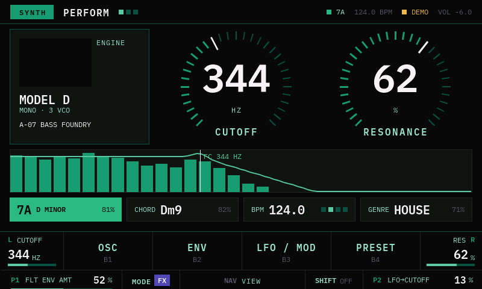
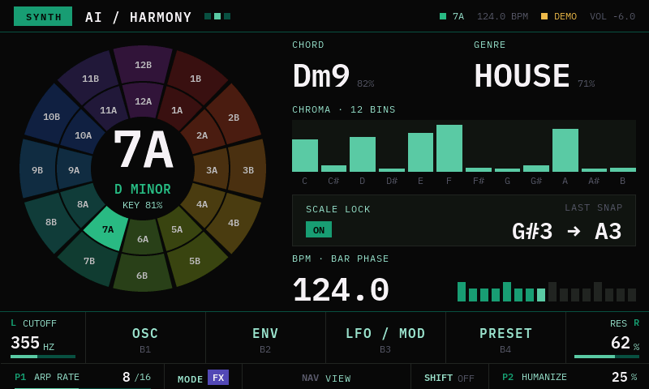
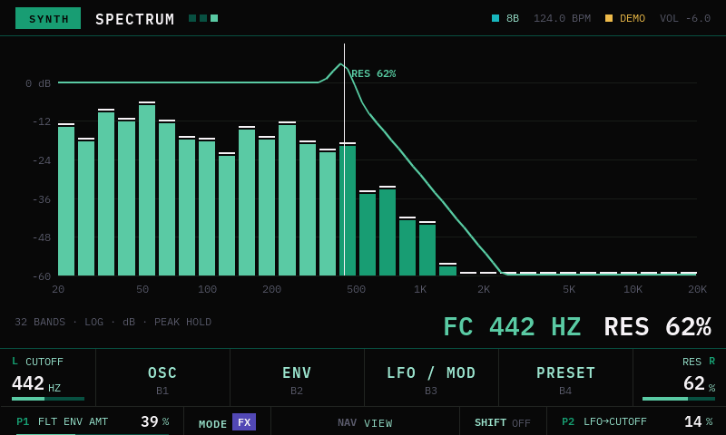
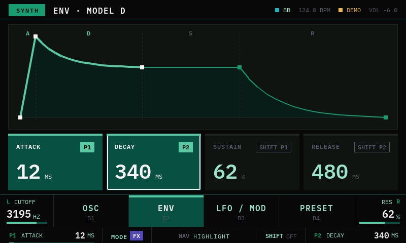

# Studio head

Cabeza gráfica de **GrooveForge Brain · Studio**: UI de 800×480 en LVGL 8.4, para la Raspberry Pi
con la pantalla Freenove de 5" (o un simulador SDL en la Mac).

- Arquitectura: [`apps/docs/variants/studio/theory/01-studio-head-architecture.md`](../docs/variants/studio/theory/01-studio-head-architecture.md)
- Decisión: [ADR-002](../docs/adr/ADR-002-variante-studio.md) · panel: [ADR-004](../docs/adr/ADR-004-panel-studio.md)
- Diseño vigente: [`apps/docs/variants/studio/design/`](../docs/variants/studio/design/README.md) (UI v3)



| AI / HARMONY | SPECTRUM | ENV |
|---|---|---|
|  |  |  |

## Estado

| Hecho | Pendiente |
|---|---|
| CMake + LVGL 8.4 + lv_drivers (SDL y framebuffer/evdev) | hilo de I/O con el bridge (tarea 38) |
| Tipografía IBM Plex Mono: 7 tamaños, pesos 400 y 600 | transporte de replay (36) |
| Modo demo: cutoff, espectro, tonalidad, cromagrama y BPM animados | |
| Splash, PERFORM, AI / HARMONY, SPECTRUM y ENV de la UI v3 | FX MAIN (con visualización), PRESETS, ENGINE SELECT, OSC, LFO, overlays |
| Navegación: NAV entre vistas, B2 abre/cierra ENV, MODE, SHIFT | ilustraciones de los engines (120×80 RGB565) |
| `--snapshot` para guardar la pantalla en un archivo | systemd, watchdog, solo lectura (43) |

Hoy la app corre **sin Teensy**: todos los datos los inventa `src/sim/demo_source.cpp`. Cuando
llegue el hilo de I/O, el mismo `StudioState` se va a llenar con los frames del bridge.

## En la Mac (simulador)

Requiere CMake y SDL2 (`brew install cmake sdl2`).

```bash
cd apps/studio-head
cmake -B build -DSTUDIO_PERF=ON        # STUDIO_PERF muestra fps y CPU
cmake --build build -j8
./build/studio-head                    # abre una ventana de 800×480
```

Captura sin ventana interactiva (sale sola):

```bash
./build/studio-head --snapshot ai.ppm --snapshot-ms 3000 --page ai      # perform | ai | spectrum | env
```

**Navegación en el demo** (mientras no hay controles físicos conectados):

| Acción | Touch (Pi) | Teclado (simulador) |
|---|---|---|
| NAV: PERFORM → AI → SPECTRUM | tocar la barra superior | ← → |
| B1–B4 (B2 abre y cierra ENV) | tocar la soft-key | 1–4 |
| B5 MODE | tocar la celda MODE | M |
| B6 SHIFT | tocar la celda SHIFT | S |

## En la Raspberry Pi (Pi 5 para desarrollar, después la 3B o la 2B)

1. **Arrancar en consola, no en el escritorio.** El escritorio es dueño de la pantalla y taparía
   la app. En Raspberry Pi OS: `sudo raspi-config` → System Options → Boot → Console. Si también
   hay un monitor HDMI conectado, desconéctalo para que `/dev/fb0` sea la pantalla DSI.
2. **Copiar el código desde la Mac** (sin `build/`):
   ```bash
   rsync -av --exclude build apps/studio-head/ pi@raspberrypi.local:~/studio-head/
   ```
3. **Compilar en la Pi:**
   ```bash
   sudo apt install -y cmake build-essential git
   cd ~/studio-head
   cmake -B build -DSTUDIO_DISPLAY=FBDEV -DSTUDIO_PERF=ON
   cmake --build build -j4
   ```
4. **Encontrar el touch:** `cat /proc/bus/input/devices` y buscar el panel de Freenove (su
   `Handlers` dice `eventN`).
5. **Correr:**
   ```bash
   sudo ./build/studio-head --touch /dev/input/eventN
   ```
   Para no usar `sudo`, agrega tu usuario a los grupos `video` e `input` y vuelve a entrar.

La primera configuración baja LVGL y lv_drivers de GitHub, así que necesita internet.

**Verificado en la Pi 5 (2026-10-09):** Raspberry Pi OS sobre Debian 13 (trixie), aarch64. La Freenove
aparece como `DSI-1` a 800×480 y `/dev/fb0` es la pantalla DSI (32 bpp; el driver convierte desde
RGB565). El touch es un `ft5x06` en `/dev/input/event5`. Sin `sudo`, `cmake` se instala en el usuario:

```bash
python3 -m venv ~/.venvs/cmake && ~/.venvs/cmake/bin/pip install cmake
~/.venvs/cmake/bin/cmake -B build -DSTUDIO_DISPLAY=FBDEV -DSTUDIO_PERF=ON
```

## Estructura

```
src/
├── main.cpp              arranque, bucle, --snapshot
├── hal/                  tick y pantalla/input (SDL o framebuffer + evdev)
├── state/studio_state.h  espejo del estado del Brain (lo único que dibuja la UI)
├── sim/                  modo demo
├── ui/                   tokens (theme), barras superior e inferior, splash, PERFORM
└── fonts/                IBM Plex Mono generada (tools/gen-fonts.sh)
include/                  lv_conf.h, lv_drv_conf.h
assets/fonts/             TTF de IBM Plex Mono (licencia SIL OFL 1.1)
```

Para regenerar las fuentes: `tools/gen-fonts.sh` (usa `npx lv_font_conv`).
