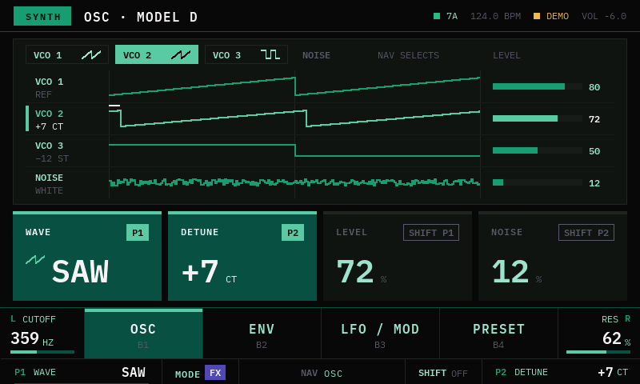
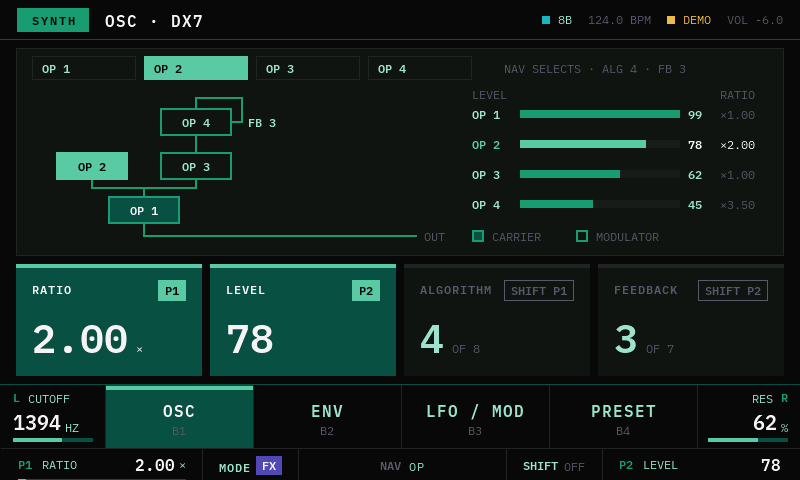
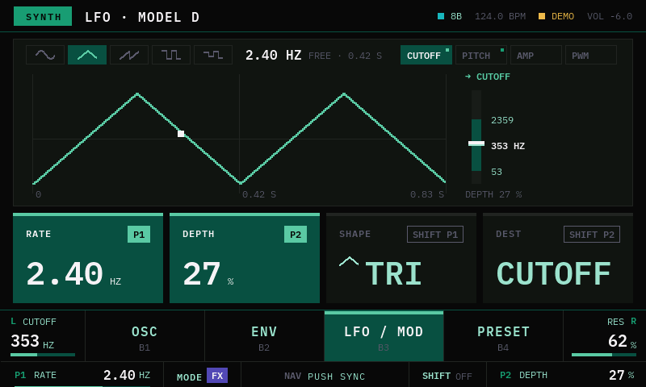
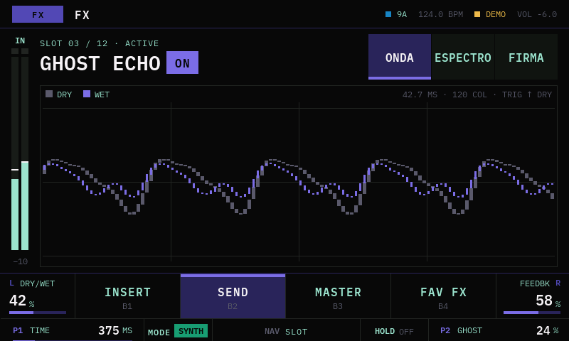
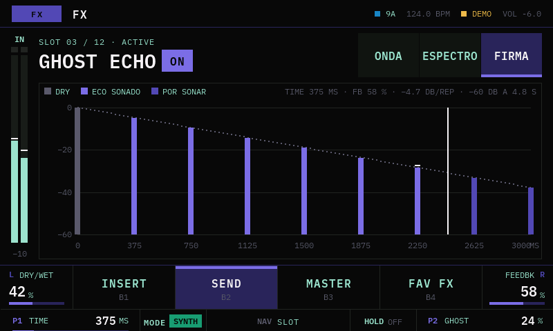
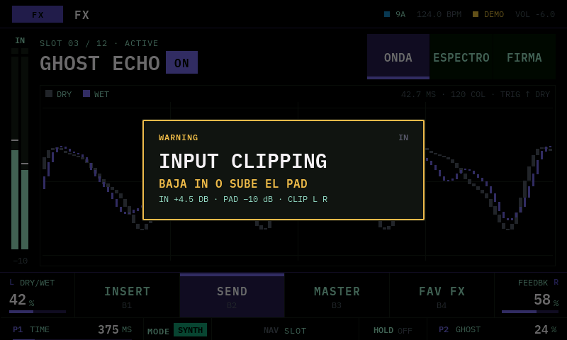
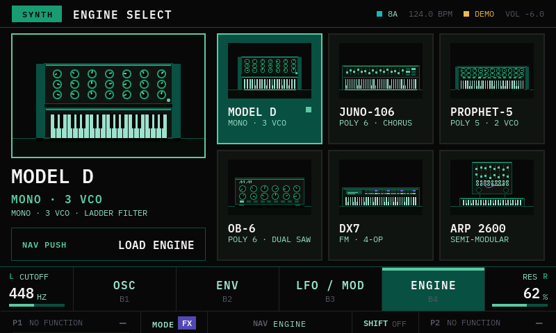
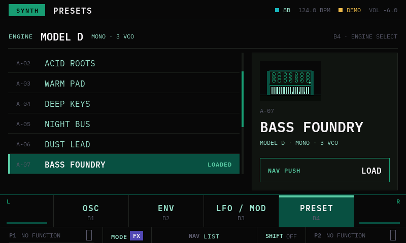
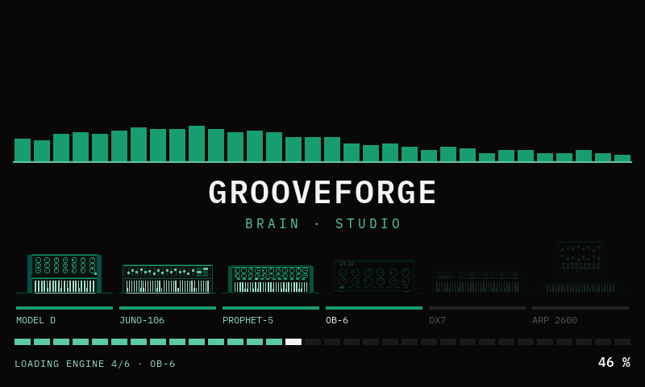

# Studio head

Cabeza gráfica de **GrooveForge Brain · Studio**: UI de 800×480 en LVGL 8.4, para la Raspberry Pi
con la pantalla Freenove de 5" (o un simulador SDL en la Mac).

- Arquitectura: [`apps/docs/variants/studio/theory/01-studio-head-architecture.md`](../docs/variants/studio/theory/01-studio-head-architecture.md)
- Decisión: [ADR-002](../docs/adr/ADR-002-variante-studio.md) · panel: [ADR-004](../docs/adr/ADR-004-panel-studio.md) · DX7: [ADR-005](../docs/adr/ADR-005-dx7-cuatro-operadores.md)
- Diseño vigente: [`apps/docs/variants/studio/design/`](../docs/variants/studio/design/README.md) (UI v3 + FX Viz + OSC/LFO, 2026-10-12)


| AI / HARMONY | SPECTRUM | ENV |
|---|---|---|
|  |  |  |

| OSC (Model D) | OSC (DX7, 4 operadores) | LFO / MOD |
|---|---|---|
|  |  |  |

| FX MAIN · ONDA | FX MAIN · FIRMA | INPUT CLIPPING |
|---|---|---|
|  |  |  |

| ENGINE SELECT | PRESETS | Splash animado |
|---|---|---|
|  |  |  |

## Estado

| Hecho | Pendiente |
|---|---|
| CMake + LVGL 8.4 + lv_drivers (SDL y framebuffer/evdev) | hilo de I/O con el bridge (tarea 38) |
| Tipografía IBM Plex Mono: 7 tamaños, pesos 400 y 600 | transporte de replay (36) |
| Modo demo: cutoff, espectro, tonalidad, cromagrama, BPM, flujos de FX y fase del LFO | sd_notify + watchdog, solo lectura (43) |
| Todas las pantallas de la UI v3: PERFORM, AI, SPECTRUM, ENV, OSC, LFO / MOD, ENGINE SELECT, PRESETS, error de conexión | LFO en el firmware (la página es la especificación) |
| FX MAIN con las vistas ONDA, ESPECTRO y FIRMA (9 FX), HOLD y bypass | engine DX7 de 4 operadores en el firmware (ADR-005) |
| Overlays: VOL, IN, toast de bypass, banner de modo, INPUT CLIPPING; splash animado | arranque ≤12 s medido en la 3B |
| Ilustraciones de los 6 engines dibujadas en C (sin assets) | |
| `--snapshot` (incluye los overlays) | |
| Modo kiosko: servicio systemd, regla udev, consola fuera de la pantalla (`deploy/`) | |

**Medido en la Pi 3 Model B v1.2 (2026-10-12):** 30 fps; 23–40 % de **un** núcleo según la pantalla
(el peor caso es SPECTRUM; OSC, LFO y FX MAIN rondan el 25 %). Ese número incluye la simulación
del modo demo.

Hoy la app corre **sin Teensy**: todos los datos los inventa `src/sim/demo_source.cpp`. Cuando
llegue el hilo de I/O, el mismo `StudioState` se va a llenar con los frames del bridge.

## En la Mac (simulador)

Requiere CMake y SDL2 (`brew install cmake sdl2`).

```bash
cd apps/studio-head
cmake -B build -DSTUDIO_PERF=ON        # STUDIO_PERF muestra fps y CPU
cmake --build build -j8
./build/studio-head                    # abre una ventana de 800×480
```

Captura sin ventana interactiva (sale sola):

```bash
./build/studio-head --snapshot ai.ppm --page ai     # perform ai spectrum env osc lfo fx engine presets error
./build/studio-head --snapshot osc.ppm --page osc --engine 4 --shift   # DX7, selector de algoritmos
./build/studio-head --snapshot fx.ppm --page fx --fx-view signature --fx-slot 5
./build/studio-head --snapshot clip.ppm --page fx --overlay clip       # vol in toast banner clip
./build/studio-head --snapshot boot.ppm --page boot --snapshot-ms 3100 # un cuadro del splash
```

Por defecto la captura se toma cuando ya terminó el splash (6.1 s).

**Navegación en el demo** (mientras no hay controles físicos conectados):

| Acción | Touch (Pi) | Teclado (simulador) |
|---|---|---|
| NAV girar (vistas; oscilador en OSC; slot en FX; cursor en listas) | deslizar ← →, o tocar la barra superior | ← → |
| NAV push (cargar en listas; SYNC en LFO; on/bypass en FX) | tocar la caja NAV PUSH, la gráfica de LFO o la píldora ON/BYPASS | Enter |
| B1 OSC · B2 ENV · B3 LFO / MOD (la misma tecla vuelve) · B4 PRESETS → ENGINE SELECT | tocar la soft-key | 1–4 |
| B5 MODE (SYNTH ⇄ FX) | tocar la etiqueta SYNTH / FX de la barra superior (o la celda MODE) | M |
| B6: SHIFT en SYNTH, HOLD (mantener) en FX | tocar / mantener la celda B6 | S / H |
| ENGINE SELECT · cargar un engine | tocar la card del engine · tocar una tile | E |
| PRESETS | tocar una fila = cursor, otra vez = cargar; deslizar ↑ ↓ = página | ← → Enter |
| OSC: siguiente oscilador | tocar la gráfica | ← → |
| ENC L push (filter bypass) | tocar el dial de cutoff | B |
| Vista de FX MAIN | tocar una pestaña o la gráfica | V |
| VOL · IN · PAD | — | − = · [ ] · P |
| Simular enlace perdido | — | L |

## En la Raspberry Pi (Pi 3 Model B v1.2 como cabeza; la Pi 5 para desarrollar)

1. **Arrancar en consola, no en el escritorio.** El escritorio es dueño de la pantalla y taparía
   la app. En Raspberry Pi OS: `sudo raspi-config` → System Options → Boot → Console. Si también
   hay un monitor HDMI conectado, desconéctalo para que `/dev/fb0` sea la pantalla DSI.
2. **Copiar el código desde la Mac** (sin `build/`):
   ```bash
   rsync -av --exclude build apps/studio-head/ pi@raspberrypi.local:~/studio-head/
   ```
3. **Compilar en la Pi:**
   ```bash
   sudo apt install -y cmake build-essential git
   cd ~/studio-head
   cmake -B build -DSTUDIO_DISPLAY=FBDEV -DSTUDIO_PERF=ON
   cmake --build build -j4
   ```
4. **Encontrar el touch:** `cat /proc/bus/input/devices` y buscar el panel de Freenove (su
   `Handlers` dice `eventN`).
5. **Correr:**
   ```bash
   sudo ./build/studio-head --touch /dev/input/eventN
   ```
   Para no usar `sudo`, agrega tu usuario a los grupos `video` e `input` y vuelve a entrar.

La primera configuración baja LVGL y lv_drivers de GitHub, así que necesita internet.

**Verificado en la Pi 3 Model B v1.2 (2026-10-12):** Raspberry Pi OS Lite de 32 bits (trixie). La
Freenove **no** se detecta sola: hace falta `dtoverlay=vc4-kms-dsi-7inch` al final de
`/boot/firmware/config.txt` (el driver de la pantalla oficial de 7", que es 800×480 con touch
ft5x06, igual que la Freenove de 5"). Queda como `DSI-1` a 800×480, `/dev/fb0` a 16 bpp (sin
conversión) y el touch en `/dev/input/event0`. `cmake` y `git` desde apt.

**Verificado en la Pi 5 (2026-10-09):** Raspberry Pi OS sobre Debian 13 (trixie), aarch64. La Freenove
aparece como `DSI-1` a 800×480 y `/dev/fb0` es la pantalla DSI (32 bpp; el driver convierte desde
RGB565). El touch es un `ft5x06` en `/dev/input/event5`. Sin `sudo`, `cmake` se instala en el usuario:

```bash
python3 -m venv ~/.venvs/cmake && ~/.venvs/cmake/bin/pip install cmake
~/.venvs/cmake/bin/cmake -B build -DSTUDIO_DISPLAY=FBDEV -DSTUDIO_PERF=ON
```

## Modo kiosko (arranque automático en la Pi)

Una vez compilado en la Pi:

```bash
sudo ~/grooveforge/studio-head/deploy/install-kiosk.sh
```

Copia el binario a `/opt/studio-head/`, instala la regla udev (`/dev/studio-touch`) y el servicio
`studio-head.service` (arranca en `sysinit`, sin esperar red ni login; se reinicia solo si se cae),
saca el login de tty1 y deja `cmdline.txt` sin logo, sin cursor y sin apagar la pantalla. Guarda
copias `.studio-bak` de `cmdline.txt` y `config.txt`. Volver a correrlo actualiza el binario;
`deploy/uninstall-kiosk.sh` deshace todo. Pendiente: `Type=notify` + watchdog (theory doc §8.1).

## Estructura

```
src/
├── main.cpp              arranque, bucle, --snapshot
├── hal/                  tick y pantalla/input (SDL o framebuffer + evdev)
├── state/                espejo del estado del Brain (lo único que dibuja la UI) y catálogos
│                         de FX (05 §1) y osciladores por engine (tabla del firmware)
├── sim/                  modo demo
├── ui/                   tokens, barras, una clase por pantalla, overlays, painter (dibujo directo),
│                         fx_viz (gráficas de FX MAIN), edit_* (OSC / LFO), engines (ilustraciones)
└── fonts/                IBM Plex Mono generada (tools/gen-fonts.sh)
include/                  lv_conf.h, lv_drv_conf.h
assets/fonts/             TTF de IBM Plex Mono (licencia SIL OFL 1.1)
```

Para regenerar las fuentes: `tools/gen-fonts.sh` (usa `npx lv_font_conv`).
